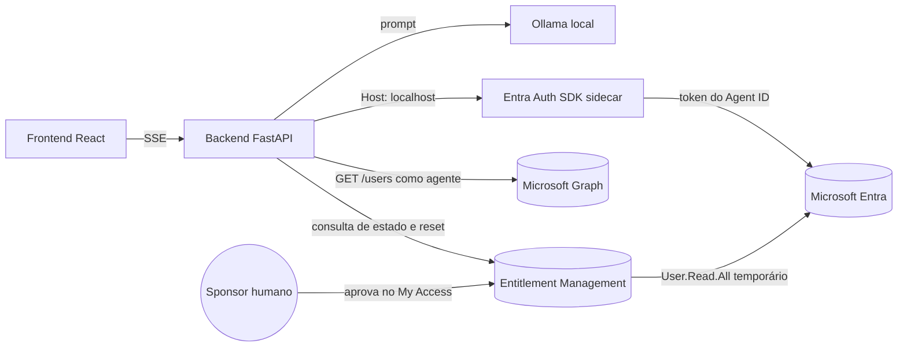

<!-- markdownlint-disable MD013 MD025 -->

# Acesso sob demanda para agentes de IA com Microsoft Entra Agent ID e Microsoft Entra ID Governance


> **Resumo:** este artigo demonstra um agente autônomo com identidade própria no Microsoft
> Entra. Ao receber uma tarefa, o agente interpreta o objetivo, seleciona uma capacidade
> no catálogo de acessos e verifica se já está autorizado a usá-la. Somente quando conclui
> que a permissão é necessária e ainda não foi concedida, ele solicita um
> Access Package para a própria identidade, apresenta a justificativa da decisão e aguarda
> a aprovação humana. A chamada que inicialmente retorna **HTTP 403** passa a retornar
> **HTTP 200** após a entrega temporária da permissão.
>
> **Estado dos produtos:** a governança de Agent IDs por Access Packages está em
> **preview**. O comportamento descrito foi validado em um tenant real em **9 de agosto de
> 2026**. Confirme licenciamento, APIs e limitações na documentação oficial antes de usar o
> padrão em produção.

## Conteúdo

1. [Motivação](#1-motivação)
2. [Cenário demonstrado](#2-cenário-demonstrado)
3. [Decisão de identidade](#3-decisão-de-identidade)
4. [Arquitetura e responsabilidades](#4-arquitetura-e-responsabilidades)
5. [Licenças e pré-requisitos](#5-licenças-e-pré-requisitos)
6. [Implementação](#6-implementação)
7. [Resultados observados](#7-resultados-observados)
8. [Segurança e caminho para produção](#8-segurança-e-caminho-para-produção)
9. [Solução de problemas](#9-solução-de-problemas)
10. [Como executar](#10-como-executar)
11. [Conclusão](#11-conclusão)
12. [Referências](#12-referências)

---

## 1. Motivação

À medida que agentes de IA assumem tarefas com maior autonomia, eles passam a interagir com
APIs, dados e recursos corporativos. Consultar um diretório, gerar um relatório ou acionar
um sistema interno exige mais do que autenticação: exige uma resposta clara para quatro
perguntas de governança.

- **Quem executou a ação?**
- **Qual acesso era necessário?**
- **Quem aprovou esse acesso?**
- **Quando a concessão deve terminar?**

Uma conta de usuário convencional foi projetada para padrões de autenticação e ciclo de vida
humanos. Um service principal convencional identifica uma aplicação, mas não oferece, por
si só, o contexto específico de um agente: sponsor responsável, identidade dedicada,
restrições próprias da plataforma e ciclo de vida controlado por um blueprint.

O Microsoft Entra Agent ID fornece essa identidade específica. Em conjunto, o Microsoft
Entra ID Governance permite transformar uma permissão permanente em um processo de acesso
sob demanda: o agente começa sem a autorização, apresenta uma justificativa, aguarda uma
decisão humana e recebe uma concessão temporária e auditável.

Esse é o objetivo da demonstração: aplicar o princípio de **menor privilégio** a uma
identidade não humana que toma decisões de forma autônoma.

---

## 2. Cenário demonstrado

A tarefa do agente é consultar usuários no Microsoft Graph para produzir um relatório de
onboarding. A operação escolhida como prova é:

```http
GET https://graph.microsoft.com/v1.0/users?$top=1
```

O fluxo esperado é:

1. O agente compara a tarefa com o catálogo de capacidades governadas.
2. O modelo local decide se a tarefa requer acesso e qual permissão a atende.
3. Se não houver necessidade, o fluxo termina sem obter token nem consultar o Graph.
4. Se houver, o agente obtém um token app-only usando sua **Agent Identity** e verifica a
    capacidade selecionada.
5. Sem `User.Read.All`, a chamada ao Graph retorna **403**.
6. O agente cria um `accessPackageAssignmentRequest` para a própria identidade, incluindo
    a justificativa da decisão.
7. A política do Access Package encaminha o pedido para aprovação.
8. O sponsor aprova no portal My Access.
9. O Entitlement Management entrega `User.Read.All` com expiração configurada.
10. Um novo token contém `roles: ["User.Read.All"]`.
11. A mesma chamada ao Graph retorna **200**.


A aplicação usa:

- **React + Vite** no frontend;
- **FastAPI + httpx** no backend;
- **Ollama** com `gpt-oss:20b` para a decisão de acesso;
- **Microsoft Entra ID Auth SDK sidecar** para aquisição de tokens;
- **Docker Compose** para executar a demonstração localmente.

---

## 3. Decisão de identidade

O primeiro passo não é escolher o framework do agente. É escolher o tipo de identidade.

A orientação atual do Microsoft Entra distingue:

| Tipo | Quando usar |
| --- | --- |
| **Agent Identity** | Quando o agente age em nome próprio ou participa de operações autônomas/interativas |
| **Agent's user account** | Quando o recurso exige um objeto de usuário, como uma caixa de correio ou canal do Teams |
| **Service principal convencional** | Para workloads determinísticos e estáticos, sem as capacidades específicas de governança de agentes |
| **Conta de usuário convencional** | Não recomendada para representar um agente |

Nesta demonstração, o recurso é uma **permissão de aplicação do Microsoft Graph**. Não há
necessidade de caixa de correio, UPN ou outro recurso que exija um objeto de usuário. Por
isso, a arquitetura usa:

- uma **Agent Identity**;
- o padrão de operação **autônomo**;
- token app-only;
- **nenhuma Agent User Account**.

A recomendação também é usar uma identidade por agente lógico e um blueprint por fronteira
de confiança. Como existe um único agente em um único runtime, a demo usa um blueprint e uma
Agent Identity.

---

## 4. Arquitetura e responsabilidades



A demo separa duas responsabilidades:

| Identidade | Responsabilidade | Privilégio nesta implementação |
| --- | --- | --- |
| **Agent Identity** | Chamar o Graph e solicitar o próprio Access Package | Começa sem `User.Read.All`; não recebe `EntitlementManagement.ReadWrite.All` |
| **Aplicação de controle/provisionamento** | Criar os objetos de Agent ID, consultar a timeline e remover a atribuição no reset | Possui permissões administrativas amplas para simplificar a demo |

Essa concentração de responsabilidades é uma simplificação da demonstração, não uma
recomendação para produção. Para reduzir o número de componentes, a mesma aplicação atua no
provisionamento, na observabilidade e nas operações de reset. Em produção, use identidades
separadas para cada função e atribua somente os papéis necessários do Entitlement
Management, como **Access package assignment manager**, em vez de conceder permissões
administrativas amplas a uma única aplicação.

---

## 5. Licenças e pré-requisitos

### 5.1 Licenciamento

Para analisar o licenciamento deste cenário, considere duas dimensões:

1. um produto-base que inclua Microsoft Entra ID P1 ou P2; e
2. uma oferta que inclua as capacidades de governança para agentes, como o Microsoft
    Agent 365.

| Referência | Utilização |
| --- | --- |
| **Microsoft 365 E7** | Oferta indicada pela Microsoft como incluindo Agent 365 e Microsoft Entra Suite; confirme os termos aplicáveis ao tenant |
| **Microsoft Agent 365 + Microsoft Entra ID P2 ou Microsoft 365 E5** | Alternativa a avaliar quando o tenant também utiliza capacidades adicionais para identidades humanas |

A licença **Microsoft Agent 365** possibilita as seguintes capacidades:

- Agent IDs e service principals como targets de Access Packages;
- API permissions em Access Packages;
- solicitação pelo sponsor em nome do agente;
- Agent Sponsors como aprovadores;
- expiração das atribuições;
- experiências de My Access aplicáveis ao fluxo.

### 5.2 Papéis administrativos

Para criar o Access Package, um **Identity Governance Administrator** é suficiente em muitos
cenários. Nesta demonstração, porém, o pacote inclui uma permissão OAuth de aplicação. Para
adicionar **API permissions** ou funções de diretório ao pacote, a documentação exige
**Global Administrator**. O catálogo passa a ser considerado privilegiado.

Para criar e gerenciar os objetos de Agent ID, use um dos papéis suportados, como:

- **Agent Identity Developer**;
- **Agent Identity Administrator**;
- **Application Administrator**, conforme a operação.

### 5.3 Ferramentas locais

- Docker Desktop;
- Python 3.12 ou superior;
- Azure CLI autenticado no tenant;
- Ollama em `localhost:11434`;
- modelo `gpt-oss:20b` disponível no Ollama;
- Node.js apenas se o frontend for executado fora do container.

### 5.4 Permissões da aplicação de provisionamento

A demo automatiza o setup com uma aplicação dedicada em fluxo `client_credentials`. Ela
recebe permissões do Microsoft Graph para criar blueprints, principals, Agent Identities e
objetos do Entitlement Management.

Entre as permissões configuradas estão:

```text
AgentIdentityBlueprint.Create
AgentIdentityBlueprint.ReadWrite.All
AgentIdentityBlueprint.AddRemoveCreds.All
AgentIdentityBlueprintPrincipal.Create
AgentIdentity.Create.All
AgentIdentity.ReadWrite.All
Application.ReadWrite.All
Directory.Read.All
EntitlementManagement.ReadWrite.All
```

> Esse conjunto favorece a reprodutibilidade da demonstração, não o menor privilégio de uma
> implantação final. Separe os processos e reduza as permissões para cada responsabilidade
> em produção.

---

## 6. Implementação

### 6.1 Estrutura do projeto

```text
backend/                 # FastAPI, clientes Graph/sidecar/Ollama e orquestração
frontend/                # dashboard React + EventSource
provisioning/            # criação do blueprint, principal e Agent Identity
scripts/                 # automações auxiliares da demonstração
docker-compose.yml       # sidecar + backend + frontend
README.md                # requisitos e instruções operacionais do projeto
```

Os arquivos centrais são `provisioning/provision_agent.py`,
`backend/app/entitlement.py`, `backend/app/demo_flow.py`, `backend/app/ollama.py` e
`frontend/src/App.jsx`. Os trechos a seguir foram reduzidos para destacar as decisões
relevantes; consulte o
[repositório da demonstração](https://github.com/Soucheff/Microsoft-Entra-AgentID-IGA)
para tratamento de erros e detalhes de execução.

### 6.2 Autenticação do processo de provisionamento

As APIs de Agent ID são chamadas com uma aplicação dedicada, não com o token do Azure CLI.
O helper usa `ClientSecretCredential` e solicita o escopo `.default` do Graph:

```python
from azure.identity import ClientSecretCredential


def graph_token() -> str:
    credential = ClientSecretCredential(
        tenant_id=env("AZURE_TENANT_ID"),
        client_id=env("AZURE_CLIENT_ID"),
        client_secret=env("AZURE_CLIENT_SECRET"),
    )
    return credential.get_token("https://graph.microsoft.com/.default").token
```

O script não reutiliza a sessão criada por `az login`. O token emitido para o Azure CLI
inclui a permissão delegada ampla `Directory.AccessAsUser.All`; por segurança, as APIs de
Agent ID recusam tokens que contenham essa permissão e retornam HTTP 403.

Por isso, a demonstração usa uma aplicação dedicada e o fluxo app-only
`client_credentials`. Nesse fluxo, o escopo `.default` inclui no token as permissões de
aplicação do Microsoft Graph previamente configuradas e consentidas para essa identidade,
como as permissões específicas de criação e gerenciamento de Agent IDs. Essa abordagem
também permite execução não interativa e identifica claramente nos logs qual aplicação
realizou o provisionamento.

### 6.3 Blueprint, BlueprintPrincipal e Agent Identity

O modelo de objetos é:

```text
Agent Identity Blueprint (application)
└── BlueprintPrincipal (service principal)
    └── Agent Identity (service principal especializado)
```

O BlueprintPrincipal **não é criado automaticamente**. O script cria ou reutiliza cada
objeto para que a execução seja idempotente.

```python
BLUEPRINT_NAME = "IGA Agent Demo Blueprint"
AGENT_NAME = "iga-demo-agent-01"


def create_blueprint(token: str, sponsor_id: str) -> dict:
    body = {
        "@odata.type": "Microsoft.Graph.AgentIdentityBlueprint",
        "displayName": BLUEPRINT_NAME,
        "sponsors@odata.bind": [f"{GRAPH_BETA}/users/{sponsor_id}"],
    }
    return request("POST", f"{GRAPH_BETA}/applications", token, json=body).json()


def create_blueprint_principal(token: str, blueprint_app_id: str) -> None:
    body = {
        "@odata.type": "Microsoft.Graph.AgentIdentityBlueprintPrincipal",
        "appId": blueprint_app_id,
    }
    request("POST", f"{GRAPH_BETA}/servicePrincipals", token, json=body)


def create_agent_identity(token: str, blueprint_app_id: str, sponsor_id: str) -> dict:
    body = {
        "@odata.type": "Microsoft.Graph.AgentIdentity",
        "displayName": AGENT_NAME,
        "agentIdentityBlueprintId": blueprint_app_id,
        "sponsors@odata.bind": [f"{GRAPH_BETA}/users/{sponsor_id}"],
    }
    return request("POST", f"{GRAPH_BETA}/servicePrincipals", token, json=body).json()
```

O sponsor deve ser um usuário. Além disso, a propagação entre a criação do blueprint, do
principal e da Agent Identity não é instantânea. O helper trata erros transitórios com
backoff:

```python
delay = 4.0
for attempt in range(retries):
    response = requests.request(method, url, headers=headers(token), timeout=30, **kwargs)
    if response.status_code < 400:
        return response
    if is_transient(response) and attempt < retries - 1:
        time.sleep(delay)
        delay = min(delay * 1.7, 40)
        continue
    return response
```


### 6.4 Criar o Access Package

No Microsoft Entra admin center:

1. Acesse **ID Governance > Entitlement management > Access packages**.
2. Crie ou selecione um catálogo.
3. Adicione `User.Read.All` como **Microsoft Graph application permission**.
4. Em **Who can get access**, selecione:
   - **For users, service principals, and agent identities in your directory**;
   - **All agents**.
5. Habilite a solicitação pelo próprio target.
6. Exija justificativa e ao menos um estágio de aprovação.
7. Defina a duração da atribuição. Na demo, o pedido usa `PT4H`.


A distinção entre **All agents** e **All service principals** é importante. A documentação
orienta a primeira opção para Agent IDs e a segunda para agentes representados por service
principals convencionais.

No tenant usado no teste, a leitura da política retornou:

```text
allowedTargetScope = allDirectoryAgentIdentities
```

Esse valor não aparecia na enumeração pública da referência v1.0 consultada durante o teste.
Trate-o como comportamento de preview observado, não como contrato estável para automação.

### 6.5 Configurar o sidecar de autenticação

O Microsoft Entra ID Auth SDK sidecar permite que o backend obtenha o token da Agent
Identity por HTTP. No ambiente local, a credencial fica no blueprint:

```yaml
sidecar:
  image: mcr.microsoft.com/entra-sdk/auth-sidecar:1.0.0-azurelinux3.0-distroless
  container_name: iga-sidecar
  environment:
    AzureAd__Instance: https://login.microsoftonline.com/
    AzureAd__TenantId: ${AZURE_TENANT_ID}
    AzureAd__ClientId: ${BLUEPRINT_APP_ID}
    AzureAd__ClientCredentials__0__SourceType: ClientSecret
    AzureAd__ClientCredentials__0__ClientSecret: ${BLUEPRINT_SECRET}
    DownstreamApis__Graph__BaseUrl: https://graph.microsoft.com/v1.0/
    DownstreamApis__Graph__Scopes__0: https://graph.microsoft.com/.default
    DownstreamApis__Graph__RequestAppToken: "true"
    ASPNETCORE_URLS: http://+:5000
```

O endpoint usado é o destinado a operações sem contexto de usuário:

```python
SIDECAR_HEADERS = {"Host": "localhost"}


async def agent_auth_header(client: httpx.AsyncClient) -> str:
    response = await client.get(
        f"{SIDECAR_URL}/AuthorizationHeaderUnauthenticated/Graph",
        params={"AgentIdentity": AGENT_APP_ID},
        headers=SIDECAR_HEADERS,
        timeout=30,
    )
    response.raise_for_status()
    return response.json()["authorizationHeader"]
```

O parâmetro `AgentIdentity` sozinho representa o padrão autônomo. O header
`Host: localhost` é uma adaptação da topologia desta demo: o sidecar aplica filtragem de host
e rejeitou o hostname do serviço Docker (`sidecar`) com `400 Invalid Hostname`.

> Não publique o sidecar em ingress, load balancer ou endpoint externo. Ele deve permanecer
> local ao workload ou à rede interna de confiança.

### 6.6 Provar a ausência de acesso

O backend usa o token do agente para executar a operação de prova:

```python
async def probe_users(client: httpx.AsyncClient, agent_auth: str) -> int:
    response = await client.get(
        "https://graph.microsoft.com/v1.0/users?$top=1",
        headers={"Authorization": agent_auth},
        timeout=15,
    )
    return response.status_code
```

Antes da atribuição, o token não contém `User.Read.All` e o Graph retorna:

```text
HTTP 403
Authorization_RequestDenied
Insufficient privileges to complete the operation.
```

### 6.7 O agente decide se precisa de acesso

O modelo local não é usado apenas para redigir um texto. Ele é o componente de decisão do
agente. A entrada contém:

- a tarefa atribuída;
- as permissões que a organização disponibilizou no catálogo de entitlements;
- a instrução explícita de aplicar menor privilégio.

O modelo deve retornar uma decisão estruturada:

```json
{
    "requires_access": true,
  "permission": "User.Read.All",
    "reason": "The task requires reading directory user profiles.",
  "justification": "The task requires enumerating directory users..."
}
```

O backend usa `/api/chat`, o modo de raciocínio `low` do `gpt-oss:20b` e um JSON Schema.
A trilha de raciocínio fica em `message.thinking`; somente a decisão final estruturada em
`message.content` é processada.

```python
DECISION_SCHEMA = {
    "type": "object",
    "properties": {
        "requires_access": {"type": "boolean"},
        "permission": {
            "type": ["string", "null"],
            "enum": ["User.Read.All", None],
        },
        "reason": {"type": "string"},
        "justification": {"type": ["string", "null"]},
    },
    "required": ["requires_access", "permission", "reason", "justification"],
    "additionalProperties": False,
}


async def analyze_access_need(client, task: str) -> AccessDecision:
    response = await client.post(
        f"{OLLAMA_URL}/api/chat",
        json={
            "model": OLLAMA_MODEL,
            "messages": [{"role": "user", "content": build_prompt(task)}],
            "format": DECISION_SCHEMA,
            "think": "low",
            "stream": False,
            "options": {"temperature": 0},
        },
        timeout=240,
    )
    payload = json.loads(response.json()["message"]["content"])
    return validate_decision(payload)
```

A validação aceita apenas a permissão publicada pela aplicação (`User.Read.All`). Se o
modelo escolher outra permissão, omitir a justificativa ou retornar JSON inválido, a decisão
é rejeitada.

O padrão de falha é **safe deny**: se o Ollama estiver indisponível, o agente não solicita
acesso. Não existe texto de fallback que crie automaticamente um pedido.

Dois testes confirmam o comportamento:

| Tarefa | Decisão do agente |
| --- | --- |
| Enumerar usuários para um relatório de onboarding | A tarefa requer `User.Read.All` |
| Calcular `21 + 21` sem usar dados corporativos | A tarefa não requer acesso catalogado |

Assim, a existência de um Access Package disponível não é motivo suficiente para usá-lo. A
tarefa precisa exigir a capacidade. Só então o agente verifica a autorização: HTTP 200
encerra o fluxo sem duplicar pedidos; HTTP 403 comprova que a concessão está ausente.

### 6.8 O agente solicita o próprio acesso

A documentação de governança de Agent IDs prevê que a própria Agent Identity solicite um
Access Package programaticamente. Esse passo só é executado quando a decisão validada contém
`requires_access=true` **e** a verificação da capacidade retorna HTTP 403. A justificativa é
uma consequência da análise, não o gatilho do processo. O corpo que funcionou nesta
implementação foi:

```python
from datetime import UTC, datetime


async def submit_self_request(client, agent_auth: str, justification: str) -> dict:
    body = {
        "requestType": "userAdd",
        "justification": justification,
        "assignment": {
            "accessPackageId": ACCESS_PACKAGE_ID,
            "assignmentPolicyId": ASSIGNMENT_POLICY_ID,
            "targetId": AGENT_OBJECT_ID,
        },
        "schedule": {
            "startDateTime": datetime.now(UTC).strftime("%Y-%m-%dT%H:%M:%SZ"),
            "expiration": {
                "type": "afterDuration",
                "duration": "PT4H",
            },
        },
    }
    response = await client.post(
        f"{GRAPH_V1}/identityGovernance/entitlementManagement/assignmentRequests",
        headers={
            "Authorization": agent_auth,
            "Content-Type": "application/json",
        },
        json=body,
        timeout=30,
    )
    response.raise_for_status()
    return response.json()
```

Pontos críticos:

- `targetId` é o **object ID do service principal especializado da Agent Identity**, não o
  `appId`;
- `userAdd` foi o tipo aceito no fluxo de self-service;
- a política precisa permitir self-add e incluir **All agents**;
- o `schedule` só pode personalizar a duração se a política permitir agenda customizada.

#### Nota sobre permissões em preview

A referência geral do endpoint lista `EntitlementManagement.ReadWrite.All` como permissão de
aplicação. Entretanto, na validação deste cenário, o token da Agent Identity não continha
essa role e o self-request foi aceito quando a política estava configurada para **All
agents**. A documentação específica de Agent ID confirma que o próprio agente pode solicitar
o pacote, mas não detalha esse contrato de autorização.

Portanto:

- considere o resultado uma **evidência do comportamento de preview validado neste tenant**;
- não conceda `EntitlementManagement.ReadWrite.All` ao agente apenas para contornar uma
  configuração incorreta da política;
- valide o mesmo fluxo no tenant de destino antes de adotá-lo como padrão.

### 6.9 Aprovação e acompanhamento do estado

Após o POST, o request percorre os estados:

```text
submitted -> pendingApproval -> delivering -> delivered
```

O sponsor recebe o pedido no My Access e visualiza a justificativa gerada pelo agente.


A demo consulta o estado com a aplicação de controle:

```python
async def request_state(client, token: str, request_id: str) -> str | None:
    url = (
        f"{EM}/assignmentRequests"
        f"?$filter=id eq '{request_id}'&$select=id,state,status"
    )
    response = await client.get(
        url,
        headers={"Authorization": f"Bearer {token}"},
        timeout=15,
    )
    items = response.json().get("value", [])
    return items[0].get("state") if items else None
```

### 6.10 Renovar o token e provar o acesso

Quando a atribuição é entregue, o app role assignment é criado para a Agent Identity. O
token que já estava no cache do sidecar continua sem a nova role até ser renovado.

Para evitar esperar a expiração natural durante uma demonstração, o backend reinicia o
container do sidecar:

```python
def restart_sidecar() -> bool:
    import docker

    docker.from_env().containers.get(SIDECAR_CONTAINER).restart()
    return True
```

Isso é uma **conveniência local da demo**, não um requisito arquitetural do Agent ID. Em
produção, não monte o Docker socket no backend. Use um desenho que permita a renovação
natural ou controlada do token sem conceder acesso ao daemon Docker.

O novo token passa a conter:

```json
{
  "roles": ["User.Read.All"]
}
```

A mesma chamada `GET /users?$top=1` retorna **HTTP 200**.

### 6.11 Transmitir a timeline ao frontend

O backend publica eventos por Server-Sent Events (SSE):

```python
@app.get("/api/run")
async def run(task: str) -> StreamingResponse:
    async def stream():
        async for event in run_demo(task):
            yield f"data: {json.dumps(event)}\n\n"

    return StreamingResponse(stream(), media_type="text/event-stream")
```

No React, `EventSource` atualiza a timeline:

```jsx
const source = new EventSource(`${API}/api/run?task=${encodeURIComponent(task)}`);

source.onmessage = (message) => {
  const event = JSON.parse(message.data);
  setSteps((current) => ({ ...current, [event.step]: event }));

    if (event.step === "reasoning") {
        setDecision({
            requiresAccess: event.requiresAccess,
            permission: event.permission,
            reason: event.reason,
            justification: event.justification,
        });
    }
  if (event.step === "probe_before") setBeforeStatus(event.httpStatus);
  if (event.step === "probe_after") setAfterStatus(event.httpStatus);
  if (event.step === "complete" || event.status === "error") source.close();
};
```


---

## 7. Resultados observados

A validação no tenant produziu as seguintes evidências:

| Etapa | Evidência |
| --- | --- |
| Token inicial | `oid` e `appid` correspondiam à Agent Identity; `roles` ausente |
| Chamada inicial | `GET /users` retornou **403 Authorization_RequestDenied** |
| Decisão positiva | Para o relatório de onboarding, o agente selecionou `User.Read.All` e justificou o pedido |
| Decisão negativa | Para uma tarefa aritmética sem dados corporativos, o agente decidiu não solicitar acesso |
| Solicitação | `userAdd` com `targetId` da Agent Identity retornou sucesso |
| Governança | Estado alterado para `pendingApproval` |
| Aprovação | Sponsor aprovou pelo My Access |
| Entrega | `User.Read.All` apareceu no app role assignment da Agent Identity |
| Novo token | Claim `roles` passou a conter `User.Read.All` |
| Chamada final | `GET /users` retornou **200** |

Os dois testes de decisão são tão importantes quanto o `403 -> 200`: demonstram que o
agente não solicita um pacote apenas porque ele existe. A tarefa precisa exigir a capacidade
publicada no catálogo. Quando o pedido é necessário, a política determina elegibilidade,
aprovação e duração.

### 7.1 Auditoria e correlação das evidências

A demonstração permite observar o fluxo em três camadas complementares:

| Fonte | Evidência disponível |
| --- | --- |
| **Dashboard da demo** | Decisão do agente, permissão selecionada, justificativa, status HTTP, `requestId` e transições de estado |
| **Logs de auditoria do Entitlement Management** | Criação da solicitação, aprovação, preparação da entrega e alterações na atribuição |
| **Logs de entrada do Microsoft Entra** | Autenticações associadas à Agent Identity, recurso acessado, resultado e identificadores do agente |

No dashboard, os eventos SSE formam uma trilha operacional da execução e ajudam a
correlacionar a decisão do agente com o `requestId` retornado pelo Entitlement Management.
Essa timeline é uma evidência visual da demo, mas não substitui um armazenamento durável de
auditoria.

No Microsoft Entra admin center, acesse **ID Governance > Entitlement management > Audit
logs** e filtre pelas categorias `EntitlementManagement` e `UserManagement`. Entre os
eventos esperados estão a solicitação do Access Package, a criação da aprovação, a decisão
do aprovador e a preparação da entrega.


Para examinar a autenticação do agente, acesse **Entra ID > Monitoring & health > Sign-in
logs** e use os filtros **Is Agent = Yes** e **Agent type = Agent Identity**. Esses registros
ajudam a confirmar qual identidade se autenticou, qual recurso foi acessado e se a operação
foi concluída com sucesso.

As chamadas ao Microsoft Graph também podem ser correlacionadas no Advanced Hunting. A
captura a seguir mostra a operação `GET /users` com `User.Read.All` e resposta HTTP 200.


Para correlacionar as três camadas, preserve pelo menos:

- data e hora da execução;
- `appId` e object ID da Agent Identity;
- `requestId` da solicitação de Access Package;
- permissão solicitada e justificativa;
- identidade e decisão do aprovador;
- resultado das chamadas antes e depois da concessão.

Em produção, envie esses dados para uma plataforma central de observabilidade, aplique
políticas de retenção e evite registrar tokens, segredos ou outros dados sensíveis.

---

## 8. Segurança e caminho para produção

Esta solução foi construída para explicitar o fluxo de governança. Alguns componentes são
intencionalmente simplificados.

### 8.1 O que manter

- uma Agent Identity por agente lógico;
- sponsor humano responsável;
- Access Packages específicos para agentes;
- escopo **All agents** ou targets específicos;
- decisão estruturada validada contra um catálogo fechado de permissões;
- padrão safe deny quando o modelo estiver indisponível ou produzir saída inválida;
- justificativa obrigatória;
- expiração curta;
- separação entre identidade do agente e control plane;
- retry com backoff e correlação de logs.

### 8.2 O que substituir

| Demo local | Produção |
| --- | --- |
| Client secret no blueprint | Managed Identity + Workload Identity Federation |
| Aplicação de provisionamento também usada para monitorar/resetar | Identidades separadas e funções delegadas do Entitlement Management |
| Docker socket no backend | Renovação de token sem acesso ao daemon Docker |
| CORS aberto | Origens explícitas e autenticação no frontend/backend |
| Estado somente em memória/SSE | Persistência, idempotência e recuperação de sessão |
| Polling a cada poucos segundos | Backoff, limites e telemetria |

### 8.3 Limitações do Access Package para agentes

Na documentação atual, Access Packages para Agent IDs podem incluir:

- associação a grupos de segurança;
- permissões OAuth de API, inclusive Microsoft Graph;
- funções Microsoft Entra permitidas para agentes.

Não reutilize pacotes que contenham application roles, SAP roles ou papéis de sites do
SharePoint para esse cenário, pois esses recursos não são suportados para Agent Identities e
service principals por esse caminho.

---

## 9. Solução de problemas

| Sintoma | Causa provável | Ação |
| --- | --- | --- |
| `403` ao chamar `/users` antes da aprovação | Comportamento esperado | Confirme que o token não contém `User.Read.All` |
| `No valid policy was found` | Política em **All service principals**, não **All agents** | Altere o target scope para **All agents** |
| `Grant null` no request | Shape incorreto ou política sem correspondência | Use `assignment.targetId`, policy ID e object ID corretos |
| `InvalidRequestExistingGrant` | Já existe atribuição ou remoção ainda está processando | Aguarde a remoção assíncrona antes de repetir |
| `400 Invalid Hostname` no sidecar | Host filtering rejeitou `sidecar:5000` | Envie `Host: localhost` ou use namespace de rede local |
| Token novo ainda sem `User.Read.All` | Cache ou propagação | Renove o token; na demo, reinicie o sidecar |
| Agente decide não solicitar e `usedLlm=false` | Ollama indisponível, JSON inválido ou permissão não suportada | Verifique `/api/tags`, o modelo `gpt-oss:20b` e os logs; o bloqueio é intencional (safe deny) |
| Modelo escolhe permissão fora do catálogo | Saída não permitida pelo JSON Schema/validador | Publique a permissão no catálogo da aplicação ou mantenha a decisão negada |
| Criação do agente falha com `object not found` | Propagação do blueprint/principal | Aplique retry com backoff |
| Access Package não aceita API permission | Papel insuficiente ou catálogo não privilegiado | Use Global Administrator e confirme o catálogo |

---

## 10. Como executar

### 10.1 Preparar o Ollama

```powershell
ollama pull gpt-oss:20b
curl.exe http://localhost:11434/api/tags
```

### 10.2 Provisionar o Agent ID

```powershell
cd provisioning
python -m venv .venv
.\.venv\Scripts\python.exe -m pip install -r requirements.txt

.\bootstrap_app.ps1
.\assign_roles.ps1
.\.venv\Scripts\python.exe provision_agent.py
```

Depois, crie o Access Package conforme a seção 6.4 e preencha em
`provisioning/.env`:

```dotenv
ACCESS_PACKAGE_ID=<id-do-access-package>
ASSIGNMENT_POLICY_ID=<id-da-politica-all-agents>
```

As principais variáveis consumidas pela aplicação são:

| Variável | Finalidade |
| --- | --- |
| `BLUEPRINT_APP_ID` | App ID do Agent Identity Blueprint |
| `BLUEPRINT_SECRET` | Segredo local do blueprint; somente para desenvolvimento |
| `AGENT_APP_ID` | App/client ID da Agent Identity usado pelo sidecar |
| `AGENT_OBJECT_ID` | Object ID da Agent Identity usado como `targetId` |
| `ACCESS_PACKAGE_ID` | Identificador do Access Package |
| `ASSIGNMENT_POLICY_ID` | Política com self-service e escopo **All agents** |
| `OLLAMA_MODEL` | Modelo local, nesta demo `gpt-oss:20b` |
| `ACCESS_DURATION` | Duração ISO 8601 da atribuição, nesta demo `PT4H` |

### 10.3 Subir a aplicação

```powershell
cd ..
.\scripts\sync-env.ps1

# Ajuste no .env raiz conforme o ambiente local:
# OLLAMA_MODEL=gpt-oss:20b
# ACCESS_DURATION=PT4H

docker compose up -d --build
docker compose ps
```

Acesse:

- dashboard: [http://localhost:5173](http://localhost:5173);
- backend: [http://localhost:8000/api/health](http://localhost:8000/api/health);
- aprovações: [https://myaccess.microsoft.com](https://myaccess.microsoft.com).

No dashboard:

1. informe a tarefa;
2. selecione **Iniciar demonstração**;
3. aguarde `pendingApproval`;
4. aprove no My Access;
5. acompanhe a entrega e o resultado final `403 -> 200`.

O botão **Resetar acesso** envia um `adminRemove`. A remoção é assíncrona; aguarde a
atribuição desaparecer antes de iniciar outra execução.

---

## 11. Conclusão

A principal contribuição desta demonstração não é a troca de um HTTP 403 por 200. É a
mudança no modelo de autorização.

Em vez de receber uma permissão permanente antes mesmo de conhecer a tarefa, o agente:

1. inicia sem acesso;
2. interpreta o objetivo e o compara com um catálogo fechado de capacidades;
3. decide qual permissão, se alguma, atende à tarefa;
4. verifica se a capacidade já está autorizada;
5. quando o acesso está ausente, apresenta a justificativa da decisão;
6. submete-se à política de governança;
7. aguarda uma decisão humana;
8. recebe acesso com prazo definido.

Microsoft Entra Agent ID fornece uma identidade própria e rastreável para o agente, o que
permite atribuir suas ações a um principal específico e produzir evidências para auditoria.
Microsoft Entra ID Governance acrescenta elegibilidade, aprovação e expiração. O resultado
é uma dupla checagem: o agente avalia a necessidade no contexto da tarefa, enquanto a
política e o aprovador verificam se a concessão deve ocorrer.

O catálogo fechado de capacidades, a validação da decisão, o comportamento safe deny e a
expiração do acesso funcionam como salvaguardas. Em vez de operar com privilégios amplos e
permanentes, o agente atua dentro de um escopo específico, associado à tarefa e limitado no
tempo. Juntos, Agent ID e ID Governance estendem os princípios de Zero Trust às identidades
de agentes: identidade explícita, menor privilégio, verificação e acesso temporário.

Esse padrão pode ser aplicado à criação de workloads especializados que auxiliem as equipes
técnicas na administração, sem eliminar os controles institucionais ou a supervisão humana.
Entre os resultados possíveis estão:

- fortalecer a governança institucional, de identidades e de IA;
- tornar decisões e solicitações de acesso mais transparentes e auditáveis;
- reduzir o tempo gasto em tarefas administrativas repetitivas;
- permitir que agentes executem atividades específicas dentro de limites previamente
    definidos, mantendo aprovação, rastreabilidade e expiração como controles do processo.

---

## 12. Referências

Documentação consultada e validada em 10 de agosto de 2026:

- [Código-fonte da demonstração: Microsoft Entra Agent ID + Identity Governance](https://github.com/Soucheff/Microsoft-Entra-AgentID-IGA)
- [Plan your agent identity architecture](https://learn.microsoft.com/en-us/entra/agent-id/how-to-plan-agent-identity-architecture)
- [Governing Agent Identities](https://learn.microsoft.com/en-us/entra/id-governance/agent-id-governance-overview)
- [Access packages for agent identities in Microsoft Entra](https://learn.microsoft.com/en-us/entra/agent-id/agent-access-packages)
- [Microsoft Entra ID Governance licensing fundamentals](https://learn.microsoft.com/en-us/entra/id-governance/licensing-fundamentals)
- [Create accessPackageAssignmentRequest](https://learn.microsoft.com/en-us/graph/api/entitlementmanagement-post-assignmentrequests)
- [Create assignmentPolicies](https://learn.microsoft.com/en-us/graph/api/entitlementmanagement-post-assignmentpolicies)
- [Microsoft Entra ID Auth SDK sidecar endpoint reference](https://learn.microsoft.com/en-us/entra/msidweb/agent-id-sdk/endpoints)
- [View reports and logs in entitlement management](https://learn.microsoft.com/en-us/entra/id-governance/entitlement-management-reports)
- [Microsoft Entra Agent ID logs](https://learn.microsoft.com/en-us/entra/agent-id/sign-in-audit-logs-agents)
- [Microsoft Agent 365 plans and pricing](https://www.microsoft.com/microsoft-agent-365#plans-and-pricing)
- [Ollama: Structured Outputs](https://docs.ollama.com/capabilities/structured-outputs)
- [Ollama: Thinking](https://docs.ollama.com/capabilities/thinking)
- [Ollama model library: gpt-oss](https://ollama.com/library/gpt-oss)
