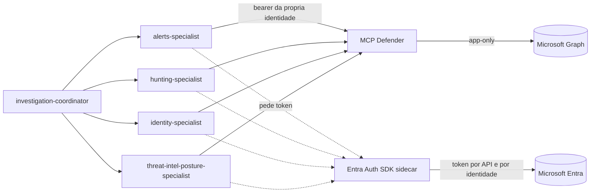
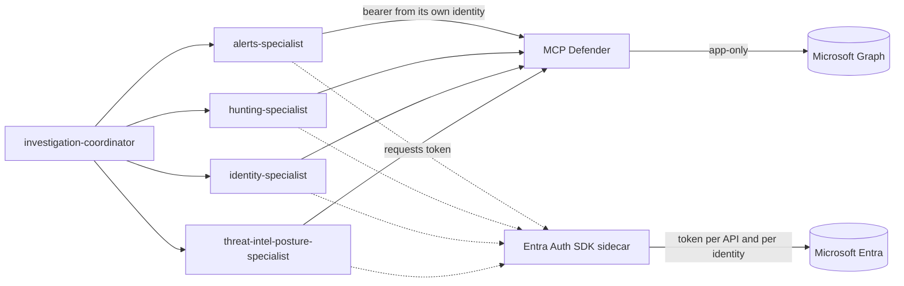

<!-- markdownlint-disable MD013 MD025 -->

<!--
  Notas internas (nao publicar):
  - Evidencias coletadas no tenant de laboratorio em 3-4 de setembro de 2026.
  - Pendencias antes de tirar draft: true -> ver rascunhos/01-checklist-publicacao.md
  - Faltam: banner.png e a captura da blade Enterprise applications (marcadas por comentario
    no corpo do texto). Publicar so depois de salvar as imagens e revisar a pubDate.
  - Repositorio da demo ainda nao tem remote publico: quando publicar, linkar em "Como executar"
    e nas Referencias (PT e EN).
-->

:::lang{pt}

# Uma identidade por agente: autorização por ferramenta com Microsoft Entra Agent ID

<!-- TODO: salvar banner em public/images/articles/uma-identidade-por-agente/banner.png e reativar

-->

> **Resumo:** o artigo anterior demonstrou um agente com identidade própria que solicita acesso
> e aguarda aprovação humana. Este artigo continua a mesma questão em outra escala: uma equipe
> de cinco agentes que compartilha um servidor MCP com trinta e duas ferramentas de segurança.
> A resposta adotada não é uma identidade única com a união de todas as permissões. Cada agente
> lógico recebe a própria Agent Identity, cada domínio de ferramenta corresponde a um app role,
> e o servidor recusa a chamada quando o token não apresenta o papel exigido. A divisão é
> verificada por testes de contrato, e não por convenção entre times.

## Conteúdo

1. [O problema da conta compartilhada, agora para agentes](#1-o-problema-da-conta-compartilhada-agora-para-agentes)
2. [Cenário demonstrado](#2-cenário-demonstrado)
3. [Modelo de identidades](#3-modelo-de-identidades)
4. [Onde a autorização é imposta](#4-onde-a-autorização-é-imposta)
5. [O token por identidade e por API](#5-o-token-por-identidade-e-por-api)
6. [A partição como invariante testável](#6-a-partição-como-invariante-testável)
7. [Verificar a superfície de permissão contra o código](#7-verificar-a-superfície-de-permissão-contra-o-código)
8. [Resultados observados](#8-resultados-observados)
9. [Segurança e caminho para produção](#9-segurança-e-caminho-para-produção)
10. [Solução de problemas](#10-solução-de-problemas)
11. [Como executar](#11-como-executar)
12. [Conclusão](#12-conclusão)
13. [Referências](#13-referências)

---

## 1. O problema da conta compartilhada, agora para agentes

Um time de agentes de investigação de segurança precisa de capacidades muito diferentes entre si.
Quem faz triagem de alertas não precisa executar KQL. Quem consulta sinais de identidade não
precisa enriquecer indicadores de comprometimento. Ainda assim, o padrão mais comum em
implementações de MCP é um único service principal com a união de todas as permissões, e a
divisão de trabalho existindo apenas como instrução em linguagem natural.

Para identidades não humanas, isso reproduz o problema que a indústria levou vinte anos para
tratar em identidades humanas: a conta compartilhada. Quando qualquer membro da equipe pode
chamar qualquer ferramenta, três perguntas de governança ficam sem resposta.

- **Qual agente executou a consulta que retornou o dado sensível?**
- **O que impede o especialista de alertas de executar uma caça no endpoint?**
- **Se a instrução do prompt mudar, o que muda naquilo que o agente pode fazer?**

A proposta deste artigo é direta de enunciar: a divisão de trabalho precisa existir no token, e
não no prompt. O prompt descreve a intenção atribuída ao agente; o token descreve o que ele está
autorizado a executar.

---

## 2. Cenário demonstrado

Uma equipe multi-agent investiga incidentes consultando um servidor MCP com trinta e duas
ferramentas de segurança sobre Microsoft Defender e Microsoft Entra. A equipe é composta pelos
seguintes membros:

| Membro | Domínio | App role |
| --- | --- | --- |
| `investigation-coordinator` | Delega e sintetiza; não chama ferramenta | — |
| `alerts-specialist` | Alertas do Defender | `Alerts.Read` |
| `hunting-specialist` | Advanced Hunting e caças temáticas | `Hunting.Read` |
| `identity-specialist` | Sinais do Microsoft Entra | `Identity.Read` |
| `threat-intel-posture-specialist` | Indicadores e postura | `ThreatIntel.Read` |

A equipe tem cinco membros, mas apenas quatro invocam ferramentas. O coordenador possui
identidade própria para que suas ações sejam atribuíveis e para que a política de dados seja
avaliada em nome dele, e ainda assim não recebe nenhum app role: sua única capacidade é delegar.
As trinta e duas ferramentas são distribuídas entre os quatro especialistas, sem interseção
entre as listas.

A verificação tem dois lados. O especialista de alertas chama `get_security_alerts` e recebe
**200**. Se o mesmo especialista chamar `run_hunting_query`, o servidor recusa a chamada,
independentemente do que o prompt determine ou do que o modelo insista em tentar.

O diagrama a seguir resume o caminho de cada chamada, da delegação do coordenador até o
Microsoft Graph:



---

## 3. Modelo de identidades

O modelo de objetos do Agent ID é o mesmo do artigo anterior, com uma diferença de cardinalidade:

```
Agent Identity Blueprint (application)
└── BlueprintPrincipal (service principal)
    ├── Agent Identity — coordinator
    ├── Agent Identity — alerts
    ├── Agent Identity — hunting
    ├── Agent Identity — identity
    └── Agent Identity — threat_intel
```

Um blueprint por fronteira de confiança e uma Agent Identity por agente lógico é a recomendação
que a demonstração segue. Como os cinco membros compartilham runtime, ciclo de vida e
patrocinador, todos derivam do mesmo blueprint. O que não compartilham é o conjunto de app roles.

Um detalhe da implementação evita trabalho desnecessário: em uma Agent Identity, o `appId` e o
object ID são o mesmo valor. O identificador usado para solicitar o token ao sidecar serve
também para as atribuições de RBAC e para a lista de aplicações autorizadas no servidor, sem
necessidade de tradução entre identificadores.

<!-- TODO: captura da blade Enterprise applications com as cinco Agent Identities

-->

---

## 4. Onde a autorização é imposta

A partição aparece em dois lugares. No cliente, cada especialista é construído com a lista de
ferramentas do seu domínio:

```python
return MCPTools(
    transport="streamable-http",
    server_params=StreamableHTTPClientParams(url=settings.mcp_endpoint, timeout=espera),
    include_tools=sorted(spec.mcp_tools),   # espelho da intenção
    header_provider=header_provider,        # bearer da Agent Identity do papel
)
```

O parâmetro `include_tools`, no entanto, é uma conveniência do cliente: ele reduz o que o modelo
enxerga, mas não impede nenhuma chamada. A imposição ocorre no servidor, em um middleware ASGI
que lê o nome da ferramenta no corpo JSON-RPC e o compara com os app roles presentes no token:

```python
PAPEL_PARA_FERRAMENTAS: dict[str, frozenset[str]] = {
    "Alerts.Read": frozenset({"get_security_alerts", "get_alert_details", ...}),
    "Hunting.Read": frozenset({"run_hunting_query", "validate_kql_query", ...}),
    "Identity.Read": frozenset({"get_signin_logs", "get_risky_users", ...}),
    "ThreatIntel.Read": frozenset({"enrich_ioc", "hunt_by_ioc", ...}),
}
```

Vale registrar uma sutileza de implementação. As chamadas MCP trafegam como JSON-RPC no corpo de
um único POST, de modo que o nome da ferramenta só é conhecido **depois** da leitura do corpo, e
esse corpo precisa ser entregue intacto ao servidor. O middleware, portanto, lê a requisição,
decide e reinjeta o conteúdo original.

---

## 5. O token por identidade e por API

Cada especialista solicita o próprio token e solicita um token distinto para cada API de destino.
O sidecar do Microsoft Entra SDK for AgentID recebe as duas dimensões na mesma requisição:

```
GET /AuthorizationHeaderUnauthenticated/Mcp?AgentIdentity={agent-app-id}
```

No log de inicialização do runtime, as identidades ativas aparecem solicitando token para a
audiência do MCP antes de qualquer investigação começar. São três, e não quatro, porque o
especialista de threat intelligence e postura é opcional e estava desligado nesta execução:

```
GET /AuthorizationHeaderUnauthenticated/Mcp?AgentIdentity=20a62a4c-... 200 OK
GET /AuthorizationHeaderUnauthenticated/Mcp?AgentIdentity=831f36e9-... 200 OK
GET /AuthorizationHeaderUnauthenticated/Mcp?AgentIdentity=1ad4c121-... 200 OK
```

O cache é indexado pelo par `(api, identidade)`. Indexar apenas pela identidade devolveria um
token emitido para a audiência errada; indexar apenas pela API devolveria o token do agente
errado. Neste desenho, o segundo caso corresponde a um bypass de autorização silencioso.

> **Armadilha de framework.** O `header_provider` do Agno é chamado sem `await`. Um provedor
> apenas assíncrono não renova o token dentro dele: o framework rebaixa a exceção a WARNING e
> prossegue **sem** o header, de modo que a falha chega ao operador disfarçada de erro de
> transporte. A solução adotada foi manter as vias síncrona e assíncrona compartilhando o mesmo
> cache.

---

## 6. A partição como invariante testável

Duas listas descrevem a mesma divisão: a do cliente e a do servidor. Listas duplicadas tendem a
divergir com o tempo, em geral quando uma ferramenta nova é adicionada em apenas um dos lados.
O monorepo trata esse risco com testes de contrato executados contra o registry real do MCP:

```python
assert declaradas - registradas == set(), "ferramenta declarada que nao existe no MCP"
assert registradas - declaradas == set(), "ferramenta do MCP sem especialista responsavel"
```

E, entre os especialistas:

```python
def test_papeis_nao_se_sobrepoem() -> None:
    """Sobreposicao tornaria ambigua a atribuicao de app roles por identidade."""
```

O efeito prático apareceu durante a escrita deste artigo. Ao adicionar a ferramenta
`get_directory_role_members`, a suíte falhou até que ela fosse declarada nos três lugares
previstos: o registry do servidor, a tabela de autorização por papel e a allowlist do
especialista responsável. Uma ferramenta sem dono não passa no build.

---

## 7. Verificar a superfície de permissão contra o código

Revisar permissões a partir de um checklist de documentação produz erros com facilidade, porque
a documentação descreve a intenção e não o código em execução. O método adotado foi outro:
enumerar cada chamada ao Microsoft Graph existente no servidor e cruzar essa lista com os app
roles efetivamente concedidos ao service principal. O inventário resultante é o seguinte:

| Permissão | Endpoint que a exige |
| --- | --- |
| `ThreatHunting.Read.All` | `security/runHuntingQuery` |
| `SecurityAlert.Read.All` | `security/alerts_v2` |
| `SecurityEvents.Read.All` | `security/secureScores` |
| `AuditLog.Read.All` | `auditLogs/signIns`, `directoryAudits` |
| `IdentityRiskyUser.Read.All` | `identityProtection/riskyUsers` |
| `IdentityRiskEvent.Read.All` | `identityProtection/riskDetections` |
| `RoleManagement.Read.Directory` | `directoryRoles` e membros |
| `Policy.Read.All` | `identity/conditionalAccess/policies` |

A verificação encontrou uma divergência que seguiria para produção sem ser notada. O
provisionamento declarava `SecurityEvents.Read.All` para a leitura de alertas, mas o código
utiliza o endpoint `alerts_v2`, que exige `SecurityAlert.Read.All`. Como o Secure Score também
aparece no inventário, as duas permissões coexistem, cada uma por um motivo distinto, informação
que a documentação interna não registrava.

A regra derivada dessa verificação é direta: **não conceder permissão sem consumidor**. Neste
ciclo, cada concessão entrou no provisionamento junto com o código que a utiliza.

---

## 8. Resultados observados

A execução no tenant de laboratório produziu as seguintes evidências:

| Verificação | Resultado |
| --- | --- |
| Token por especialista | Três identidades distintas solicitando token na inicialização |
| Audiência | Token do MCP recusado pela REST do runtime, e vice-versa |
| Ferramenta fora do papel | Recusada pelo servidor, independentemente do prompt |
| Contrato cliente/servidor | Teste falha quando as listas divergem |
| Superfície de permissão | Uma lacuna encontrada, nenhum excesso |

A recusa por papel é a evidência mais relevante do conjunto, porque não depende do comportamento
do modelo. O prompt pode instruir o especialista de alertas a executar uma caça, e o modelo pode
tentar a chamada; a decisão de negar é tomada pelo servidor, a partir do token apresentado.

---

## 9. Segurança e caminho para produção

Esta demonstração foi construída para tornar a autorização por ferramenta observável. Alguns
componentes são intencionalmente simplificados.

### 9.1 O que manter

- uma Agent Identity por agente lógico e um blueprint por fronteira de confiança;
- um app role por domínio de ferramenta, imposto no servidor;
- cache de token indexado por `(api, identidade)`;
- audiências distintas para cada superfície, de modo que um token não valha em duas;
- testes de contrato entre a partição declarada no cliente e a imposta no servidor.

### 9.2 O que substituir

| Nesta demo | Em produção |
| --- | --- |
| Client secret no blueprint (local) | Managed identity com credencial federada |
| Lista de app ids autorizados em variável | Origem governada e revisada |
| Blueprint único para os cinco membros | Um blueprint por fronteira de confiança real |

---

## 10. Solução de problemas

| Sintoma | Causa provável | Ação |
| --- | --- | --- |
| `401` no `/mcp` com token válido | Token emitido para outra audiência | Compare `MCP_AUTH_AUDIENCE` com o escopo solicitado ao sidecar |
| Ferramenta recusada para o agente correto | App role ausente no token | Decodifique o claim `roles` do token emitido |
| `AADSTS70025` no sidecar | Blueprint sem credencial configurada | Configure um client secret local ou uma credencial federada |
| `InvalidUniqueTenantIdentifierAsPerAppPolicy` | `identifierUri` sem domínio verificado ou id do tenant | Use `api://{tenantId}/{nome}` |
| Erro de transporte sem causa aparente | Exceção no `header_provider` rebaixada a WARNING | Verifique a via síncrona do provedor de token |
| Sidecar não sobe na porta 5000 no macOS | AirPlay Receiver ocupa a porta | Publique o sidecar em outra porta e ajuste `DEFENDER_SIDECAR_URL` |

---

## 11. Como executar

A demonstração é um monorepo Python. O sidecar do Microsoft Entra e o servidor MCP são
executados em Docker; o agente roda no host e alcança os dois por `localhost`, com as mesmas
variáveis que o Container App recebe no Azure.

### 11.1 Pré-requisitos

- Python 3.12, `uv` e Docker;
- um tenant com Microsoft Entra Agent ID e permissão para criar aplicações e conceder app roles;
- um projeto do Microsoft Foundry para o modelo.

### 11.2 Provisionar identidades e permissões

```bash
uv sync --all-packages --all-extras
uv run defender-agent setup --sponsor <upn-do-patrocinador>
```

O comando cria o blueprint, as Agent Identities da equipe, os app roles por domínio de
ferramenta e as concessões de Microsoft Graph utilizadas pelo servidor MCP.

### 11.3 Conferir a partição antes de executar

```bash
uv run defender-agent papeis
```

A saída lista cada especialista, o app role correspondente e as ferramentas que ele pode
invocar. É a mesma estrutura que os testes de contrato da seção 6 verificam.

### 11.4 Subir o sidecar e o MCP

```bash
cp .env.example .env   # preencher os segredos do blueprint e do app do MCP
docker compose up -d --build
docker compose ps
```

### 11.5 Executar uma investigação

```bash
uv run defender-agent investigar "alertas de alta severidade nas ultimas 24 horas" \
  --usuario <object-id-do-analista>
```

Para observar a recusa por papel, solicite explicitamente uma caça ao especialista de alertas.
O prompt chega ao modelo, a chamada chega ao servidor e o servidor a nega, sem que o resultado
dependa da instrução em linguagem natural.

---

## 12. Conclusão

A principal contribuição desta demonstração não é ter cinco identidades em vez de uma. É tornar
verificável, fora do prompt, a resposta para uma pergunta de governança: o que este agente pode
fazer?

Em vez de uma identidade única com a união das permissões, cada agente lógico:

1. recebe a própria Agent Identity, derivada de um blueprint;
2. solicita um token por API de destino, com cache indexado por identidade;
3. apresenta ao servidor apenas os app roles do seu domínio;
4. tem a chamada recusada quando invoca uma ferramenta fora do papel;
5. permanece coberto por testes que falham quando a partição declarada e a imposta divergem.

Instrução em linguagem natural descreve intenção; app role descreve permissão. As duas convivem,
mas cumprem funções distintas: a primeira orienta o comportamento do modelo, a segunda determina
o que a plataforma aceita executar. Quando um agente opera sobre dados de segurança do tenant,
tratar as duas como equivalentes é a diferença entre uma demonstração e um controle.

Aplicado a equipes maiores, esse padrão produz alguns resultados práticos:

- atribuir cada chamada a um principal específico, e não à equipe como um todo;
- limitar o impacto de um prompt mal formulado ou malicioso ao domínio de um único especialista;
- revisar permissões por inventário de código, e não por checklist de documentação;
- transformar a divisão de trabalho entre agentes em um artefato testável no pipeline.

---

## 13. Referências

Documentação consultada e validada em 3 de setembro de 2026:

- [Artigo anterior: Acesso sob demanda para agentes de IA com Microsoft Entra Agent ID e Microsoft Entra ID Governance](/artigos/entra-agentid-accesspackage)
- [Plan your agent identity architecture](https://learn.microsoft.com/en-us/entra/agent-id/how-to-plan-agent-identity-architecture)
- [Microsoft Entra ID Auth SDK (sidecar) endpoint reference](https://learn.microsoft.com/en-us/entra/msidweb/agent-id-sdk/endpoints)
- [Model Context Protocol: Transports (Streamable HTTP)](https://modelcontextprotocol.io/specification/2026-07-28/basic/transports)

<!-- TODO: adicionar o link do repositorio da demonstracao quando o remote publico existir. -->

:::

:::lang{en}

# One identity per agent: per-tool authorization with Microsoft Entra Agent ID

<!-- TODO: reactivate once the banner image exists

-->

> **Summary:** the previous article demonstrated an agent with its own identity that requests
> access and waits for human approval. This article continues the same question at a different
> scale: a team of five agents sharing an MCP server with thirty-two security tools. The answer
> adopted here is not a single identity holding the union of every permission. Each logical
> agent receives its own Agent Identity, each tool domain maps to an app role, and the server
> refuses the call when the token does not present the required role. The division is verified
> by contract tests, not by convention between teams.

## Contents

1. [The shared account problem, now for agents](#1-the-shared-account-problem-now-for-agents)
2. [Demonstrated scenario](#2-demonstrated-scenario)
3. [Identity model](#3-identity-model)
4. [Where authorization is enforced](#4-where-authorization-is-enforced)
5. [One token per identity and per API](#5-one-token-per-identity-and-per-api)
6. [The partition as a testable invariant](#6-the-partition-as-a-testable-invariant)
7. [Checking the permission surface against the code](#7-checking-the-permission-surface-against-the-code)
8. [Observed results](#8-observed-results)
9. [Security and path to production](#9-security-and-path-to-production)
10. [Troubleshooting](#10-troubleshooting)
11. [How to run](#11-how-to-run)
12. [Conclusion](#12-conclusion)
13. [References](#13-references)

---

## 1. The shared account problem, now for agents

A team of security investigation agents needs very different capabilities across its members.
Whoever triages alerts does not need to run KQL. Whoever queries identity signals does not need
to enrich indicators of compromise. Even so, the most common pattern in MCP implementations is
a single service principal holding the union of every permission, with the division of labour
existing only as natural language instruction.

For non-human identities, this reproduces the problem the industry took twenty years to address
for human identities: the shared account. When any team member can call any tool, three
governance questions have no answer.

- **Which agent ran the query that returned the sensitive data?**
- **What stops the alerts specialist from running an endpoint hunt?**
- **If the prompt instruction changes, what changes in what the agent can do?**

The proposal in this article is straightforward to state: the division of labour must live in
the token, not in the prompt. The prompt describes the intent assigned to the agent; the token
describes what it is authorized to execute.

---

## 2. Demonstrated scenario

A multi-agent team investigates incidents by querying an MCP server exposing thirty-two security
tools over Microsoft Defender and Microsoft Entra. The team is made up of the following members:

| Member | Domain | App role |
| --- | --- | --- |
| `investigation-coordinator` | Delegates and synthesizes; calls no tool | — |
| `alerts-specialist` | Defender alerts | `Alerts.Read` |
| `hunting-specialist` | Advanced Hunting and themed hunts | `Hunting.Read` |
| `identity-specialist` | Microsoft Entra signals | `Identity.Read` |
| `threat-intel-posture-specialist` | Indicators and posture | `ThreatIntel.Read` |

The team has five members, but only four invoke tools. The coordinator has its own identity so
that its actions are attributable and so that data policy is evaluated on its behalf, and even
so it receives no app role at all: its only capability is to delegate. The thirty-two tools are
distributed across the four specialists, with no intersection between the lists.

The verification has two sides. The alerts specialist calls `get_security_alerts` and receives
**200**. If the same specialist calls `run_hunting_query`, the server refuses the call,
regardless of what the prompt states or how insistently the model tries.

The diagram below summarizes the path of each call, from the coordinator's delegation to
Microsoft Graph:



---

## 3. Identity model

The Agent ID object model is the same as in the previous article, with one difference in
cardinality:

```
Agent Identity Blueprint (application)
└── BlueprintPrincipal (service principal)
    ├── Agent Identity — coordinator
    ├── Agent Identity — alerts
    ├── Agent Identity — hunting
    ├── Agent Identity — identity
    └── Agent Identity — threat_intel
```

One blueprint per trust boundary and one Agent Identity per logical agent is the recommendation
this demonstration follows. Because the five members share runtime, lifecycle and sponsor, they
all derive from the same blueprint. What they do not share is the set of app roles.

One implementation detail avoids unnecessary work: in an Agent Identity, the `appId` and the
object ID are the same value. The identifier used to request the token from the sidecar also
works for RBAC assignments and for the list of authorized applications on the server, with no
translation between identifiers.

<!-- TODO: Enterprise applications blade capture showing the five Agent Identities

-->

---

## 4. Where authorization is enforced

The partition appears in two places. On the client, each specialist is built with the list of
tools belonging to its domain:

```python
return MCPTools(
    transport="streamable-http",
    server_params=StreamableHTTPClientParams(url=settings.mcp_endpoint, timeout=espera),
    include_tools=sorted(spec.mcp_tools),   # mirrors the intent
    header_provider=header_provider,        # bearer from the role's Agent Identity
)
```

The `include_tools` parameter, however, is a client-side convenience: it narrows what the model
sees, but it prevents no call. Enforcement happens on the server, in an ASGI middleware that
reads the tool name from the JSON-RPC body and compares it with the app roles present in the
token:

```python
PAPEL_PARA_FERRAMENTAS: dict[str, frozenset[str]] = {
    "Alerts.Read": frozenset({"get_security_alerts", "get_alert_details", ...}),
    "Hunting.Read": frozenset({"run_hunting_query", "validate_kql_query", ...}),
    "Identity.Read": frozenset({"get_signin_logs", "get_risky_users", ...}),
    "ThreatIntel.Read": frozenset({"enrich_ioc", "hunt_by_ioc", ...}),
}
```

One implementation subtlety is worth recording. MCP calls travel as JSON-RPC inside the body of
a single POST, so the tool name is only known **after** the body has been read, and that body
must be handed to the server intact. The middleware therefore reads the request, decides, and
re-injects the original content.

---

## 5. One token per identity and per API

Each specialist requests its own token and requests a distinct token for each target API. The
Microsoft Entra SDK for AgentID sidecar receives both dimensions in the same request:

```
GET /AuthorizationHeaderUnauthenticated/Mcp?AgentIdentity={agent-app-id}
```

In the runtime startup log, the active identities show up requesting tokens for the MCP audience
before any investigation begins. There are three rather than four because the threat
intelligence and posture specialist is optional and was disabled in this run:

```
GET /AuthorizationHeaderUnauthenticated/Mcp?AgentIdentity=20a62a4c-... 200 OK
GET /AuthorizationHeaderUnauthenticated/Mcp?AgentIdentity=831f36e9-... 200 OK
GET /AuthorizationHeaderUnauthenticated/Mcp?AgentIdentity=1ad4c121-... 200 OK
```

The cache is keyed by the `(api, identity)` pair. Keying by identity alone would return a token
issued for the wrong audience; keying by API alone would return the wrong agent's token. In this
design, the second case amounts to a silent authorization bypass.

> **Framework pitfall.** Agno's `header_provider` is called without `await`. An async-only
> provider does not renew the token inside it: the framework downgrades the exception to WARNING
> and proceeds **without** the header, so the failure reaches the operator disguised as a
> transport error. The solution adopted was to keep the sync and async paths sharing the same
> cache.

---

## 6. The partition as a testable invariant

Two lists describe the same division: the client's and the server's. Duplicated lists tend to
drift over time, usually when a new tool is added on only one of the sides. The monorepo handles
that risk with contract tests executed against the real MCP registry:

```python
assert declaradas - registradas == set(), "declared tool that does not exist in the MCP"
assert registradas - declaradas == set(), "MCP tool with no responsible specialist"
```

And, across specialists:

```python
def test_papeis_nao_se_sobrepoem() -> None:
    """Overlap would make the per-identity app role assignment ambiguous."""
```

The practical effect showed up while this article was being written. When the
`get_directory_role_members` tool was added, the suite failed until it was declared in the three
expected places: the server registry, the per-role authorization table, and the allowlist of the
responsible specialist. A tool without an owner does not pass the build.

---

## 7. Checking the permission surface against the code

Reviewing permissions from a documentation checklist produces errors easily, because the
documentation describes intent rather than the code in execution. The method adopted was a
different one: enumerate every Microsoft Graph call present in the server and cross-check that
list with the app roles actually granted to the service principal. The resulting inventory is
as follows:

| Permission | Endpoint requiring it |
| --- | --- |
| `ThreatHunting.Read.All` | `security/runHuntingQuery` |
| `SecurityAlert.Read.All` | `security/alerts_v2` |
| `SecurityEvents.Read.All` | `security/secureScores` |
| `AuditLog.Read.All` | `auditLogs/signIns`, `directoryAudits` |
| `IdentityRiskyUser.Read.All` | `identityProtection/riskyUsers` |
| `IdentityRiskEvent.Read.All` | `identityProtection/riskDetections` |
| `RoleManagement.Read.Directory` | `directoryRoles` and members |
| `Policy.Read.All` | `identity/conditionalAccess/policies` |

The check found a divergence that would have reached production unnoticed. Provisioning declared
`SecurityEvents.Read.All` for reading alerts, but the code uses the `alerts_v2` endpoint, which
requires `SecurityAlert.Read.All`. Because Secure Score also appears in the inventory, both
permissions coexist, each for a different reason, information the internal documentation did not
record.

The rule derived from this check is direct: **do not grant a permission without a consumer**. In
this cycle, every grant entered provisioning together with the code that uses it.

---

## 8. Observed results

The run in the lab tenant produced the following evidence:

| Check | Result |
| --- | --- |
| Token per specialist | Three distinct identities requesting tokens at startup |
| Audience | The MCP token is refused by the runtime REST API, and vice versa |
| Tool outside the role | Refused by the server, regardless of the prompt |
| Client/server contract | The test fails when the lists drift apart |
| Permission surface | One gap found, no excess |

The role refusal is the most relevant piece of evidence in the set, because it does not depend on
the model's behaviour. The prompt may instruct the alerts specialist to run a hunt, and the model
may attempt the call; the decision to deny is taken by the server, based on the token presented.

---

## 9. Security and path to production

This demonstration was built to make per-tool authorization observable. Some components are
intentionally simplified.

### 9.1 What to keep

- one Agent Identity per logical agent and one blueprint per trust boundary;
- one app role per tool domain, enforced on the server;
- a token cache keyed by `(api, identity)`;
- distinct audiences per surface, so that one token is not valid on two;
- contract tests between the partition declared on the client and the one enforced on the server.

### 9.2 What to replace

| In this demo | In production |
| --- | --- |
| Client secret on the blueprint (local) | Managed identity with federated credential |
| Authorized app id list in an environment variable | A governed, reviewed source |
| A single blueprint for the five members | One blueprint per real trust boundary |

---

## 10. Troubleshooting

| Symptom | Likely cause | Action |
| --- | --- | --- |
| `401` on `/mcp` with a valid token | Token issued for another audience | Compare `MCP_AUTH_AUDIENCE` with the scope requested from the sidecar |
| Tool refused for the correct agent | App role missing from the token | Decode the `roles` claim of the issued token |
| `AADSTS70025` on the sidecar | Blueprint without a configured credential | Configure a local client secret or a federated credential |
| `InvalidUniqueTenantIdentifierAsPerAppPolicy` | `identifierUri` without a verified domain or tenant id | Use `api://{tenantId}/{name}` |
| Transport error with no apparent cause | Exception in `header_provider` downgraded to WARNING | Check the synchronous path of the token provider |
| Sidecar fails to bind port 5000 on macOS | AirPlay Receiver holds the port | Publish the sidecar on another port and adjust `DEFENDER_SIDECAR_URL` |

---

## 11. How to run

The demonstration is a Python monorepo. The Microsoft Entra sidecar and the MCP server run in
Docker; the agent runs on the host and reaches both over `localhost`, using the same variables
the Container App receives on Azure.

### 11.1 Prerequisites

- Python 3.12, `uv` and Docker;
- a tenant with Microsoft Entra Agent ID and permission to create applications and grant app roles;
- a Microsoft Foundry project for the model.

### 11.2 Provision identities and permissions

```bash
uv sync --all-packages --all-extras
uv run defender-agent setup --sponsor <sponsor-upn>
```

The command creates the blueprint, the team's Agent Identities, the per-domain app roles, and the
Microsoft Graph grants used by the MCP server.

### 11.3 Inspect the partition before running

```bash
uv run defender-agent papeis
```

The output lists each specialist, its app role and the tools it may invoke. It is the same
structure the contract tests in section 6 verify.

### 11.4 Start the sidecar and the MCP server

```bash
cp .env.example .env   # fill in the blueprint and MCP application secrets
docker compose up -d --build
docker compose ps
```

### 11.5 Run an investigation

```bash
uv run defender-agent investigar "high severity alerts in the last 24 hours" \
  --usuario <analyst-object-id>
```

To watch the role refusal, explicitly ask the alerts specialist for a hunt. The prompt reaches
the model, the call reaches the server, and the server denies it, without the outcome depending
on the natural language instruction.

---

## 12. Conclusion

The main contribution of this demonstration is not having five identities instead of one. It is
making the answer to a governance question verifiable outside the prompt: what can this agent do?

Instead of a single identity holding the union of every permission, each logical agent:

1. receives its own Agent Identity, derived from a blueprint;
2. requests one token per target API, with the cache keyed by identity;
3. presents the server only the app roles of its own domain;
4. has the call refused when it invokes a tool outside its role;
5. remains covered by tests that fail when the declared and enforced partitions diverge.

Natural language instruction describes intent; an app role describes permission. The two coexist,
but serve distinct functions: the first guides the model's behaviour, the second determines what
the platform accepts to execute. When an agent operates on the tenant's security data, treating
them as equivalent is the difference between a demonstration and a control.

Applied to larger teams, this pattern produces a few practical outcomes:

- attributing each call to a specific principal rather than to the team as a whole;
- limiting the impact of a poorly formulated or malicious prompt to a single specialist's domain;
- reviewing permissions from a code inventory rather than from a documentation checklist;
- turning the division of labour between agents into an artifact testable in the pipeline.

---

## 13. References

Documentation reviewed and validated on 3 September 2026:

- [Previous article: On-demand access for AI agents with Microsoft Entra Agent ID and Microsoft Entra ID Governance](/en/articles/entra-agentid-accesspackage)
- [Plan your agent identity architecture](https://learn.microsoft.com/en-us/entra/agent-id/how-to-plan-agent-identity-architecture)
- [Microsoft Entra ID Auth SDK (sidecar) endpoint reference](https://learn.microsoft.com/en-us/entra/msidweb/agent-id-sdk/endpoints)
- [Model Context Protocol: Transports (Streamable HTTP)](https://modelcontextprotocol.io/specification/2026-07-28/basic/transports)

:::
